# SoccerSessions

**Live demo: https://lyversemason.github.io/soccer-sessions/** (no login: pick a demo user).
There's also a version with real sign-in and a shared database: see
[The database version](#the-database-version-real-sign-in-shared-data).

SoccerSessions is a scheduling, staffing-rules and sales-intake system for a field-service
business: independent contractor coaches sent to daycares and schools across three
cities. It enforces the operating rules that keep sessions safe and staffable, stops
sales from booking a program the coaching staff can't cover, and tracks every program's
cycle to its real end date.

It's a public rebuild of a system I designed and ran at a previous job (the original
is private). This version uses fresh code and a **fictional company, Bramblewood Youth
Soccer**. Every center, coach, phone number (555-01xx) and dollar figure is made up.

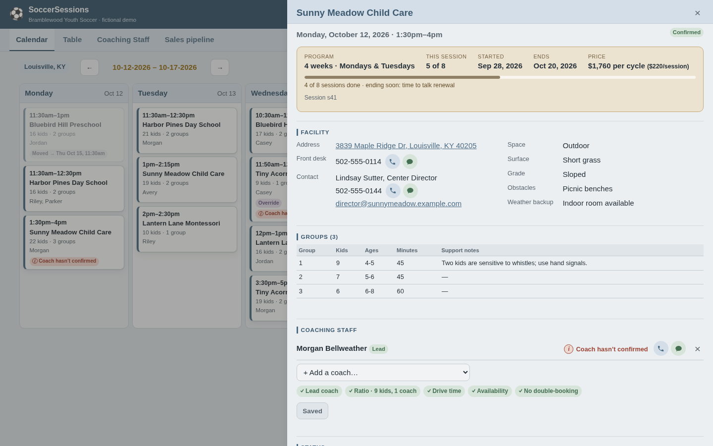

## Try it in two minutes

Turn on **Demo guide** (top right) for a short explanation on each screen.

1. **Sales rep (Jamie Ellison).** Start a new center: pick a ZIP, choose Saturdays and
   40 kids. The live check says the coaching staff **can't** cover it, Submit locks, and
   it offers open slots instead. Then open **My submissions**: Clover Patch can still be
   edited because no territory manager has confirmed it yet.
2. **Territory manager, Louisville (Priya Raman).** Open any session. The top box shows
   the program (e.g. session 5 of 8), when the cycle really ends, the price. A red **(i)** marks
   a coach who hasn't confirmed; click it to call or text them. Put an assistant on alone
   and the Save button turns amber: saving asks for the exact override warning from the spec.
3. **Coach (phone view).** Answer "Has your availability changed this week?", add a day
   off, and confirm your shifts. Then look at **Coaching Staff** as the territory manager:
   it shows who has confirmed and the day off, read-only.
4. **Ops admin (Dana Whitfield).** The dashboard lists cycles ending in the next two weeks
   (renewal time). Change the safety buffer from 30 to 60 minutes and watch new
   drive-time issues appear across territories. Then open **Accounts**, invite a coach and
   accept the invitation from the on-screen email, and find all of it in the **Audit log**.
   Finally open **Hours & pay**: coaching hours, coach pay and program revenue by week,
   3-week pay period or month, the programs that keep the least after coach pay, and a
   payroll download.

Everything you change is saved in your browser only. **Reset demo** restores it.

## What it does

| | |
|---|---|
| **Role-based access** | Ops admins see all territories; territory managers only theirs; sales reps only the intake and their own submissions; coaches only their own shifts. Coach pay rates are stripped from the data for non-managers, not just hidden. |
| **Rules engine** | Blocks double-booking. Checks drive time between centers plus a configurable safety buffer, requires a lead coach on every session, and enforces 1 coach per 12 children in a group (13 means a second coach; trainees don't count). Territory managers can override with an explicit warning, up to 18 per coach and never past that. Days off and availability count too. |
| **Sales intake** | The rep types the address and picks it from a live address search (free OpenStreetMap lookup, no API key, so it can never run up a bill). Each weekday of the program gets its own first date, times and groups (Thursdays from one week, Fridays from the next), and one price covers the whole cycle. Phone numbers format themselves, misspelled emails like `@gmail.con` are refused, and wrong fields are outlined in red with a message. A live check proves qualified coaches exist on **every** date, using the same rules with no overrides and without assigning anyone. If it can't, Submit is locked and open slots are suggested. Reps can edit a submission until a territory manager confirms it. |
| **Bulk staffing** | Staff one session, then add the same coaches to every other open session of that program they can legally work (or just its Mondays, or Thursdays) in one click. Each session gets the full rule check first, so the button only offers what it can really fill; dates the coaches can't take are listed by name with the reason and a link to staff that one date. Confirming one session with the facility then asks whether to confirm the rest of the program. |
| **Program cycles** | Every session shows "session 3 of 8" and the cycle's real end date, read from the sessions, so reschedules and make-ups push it out. Missing make-ups are flagged and cycles ending soon are listed for renewal. |
| **Session lifecycle** | Pending → confirmed → rescheduled / cancelled. **Nothing is ever deleted**: a reschedule keeps the original, links a new session and texts the coaching staff to re-confirm; a cancellation needs a reason code. Both take an optional note (up to 300 characters). Every change is logged with who and when. |
| **Territory manager views** | Week calendar with a one-day view (every territory side by side), a filterable table with live rule badges, plus Coaching Staff: click a coach to change level, pay rate or contact details (logged), and see availability and weekly check-ins read-only. |
| **Accounts** | People are added by invitation, never with a password someone hands out: ops admins invite anyone, territory managers invite coaches into their own territory. In the demo the invite email is shown on screen with a button to accept it. Turning access off locks someone out at once and lists the upcoming sessions to re-staff; nothing is deleted and every change is in the person's account history. Nobody can turn off their own access, and the last operations admin can't be removed or demoted. |
| **Audit log** | Operations admins see every logged change in the company, newest first: who, what and when, with a link to the session, coach or person it was about. Filter by person or kind of record, or search. The log can only be added to: in the database version nobody can edit or delete an entry, administrators and server code included. |
| **Hours & pay** | For management only: coaching hours, coach pay, program revenue and what's left after coach pay, for a week, a 3-week pay period or a month, split into delivered and scheduled. A week-by-week chart (click a week to open it, or show it as a table), then breakdowns by territory, by program (lowest share left after pay first, for pricing renewals) and by coach, including active coaches with no shifts. Coaches are paid for the whole session at their own rate; a program's price is split evenly over the sessions of its cycle, so make-ups don't earn twice and cancellations earn nothing. **Download payroll (CSV)** gives one row per coach per session. |
| **Coach phone view** | My shifts by day, a full shift package, tap-to-map, call and text buttons, confirm one shift or the whole week (confirmations open the Sunday before each week, never weeks ahead), a weekly "has your availability changed?" check-in, usual week, one-week changes and days off. |

<table>
<tr>
<td>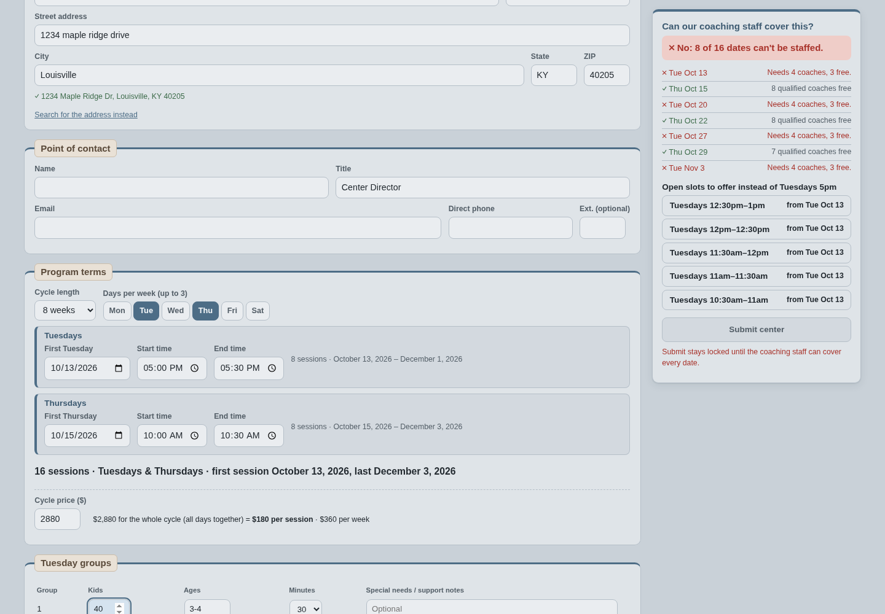</td>
<td>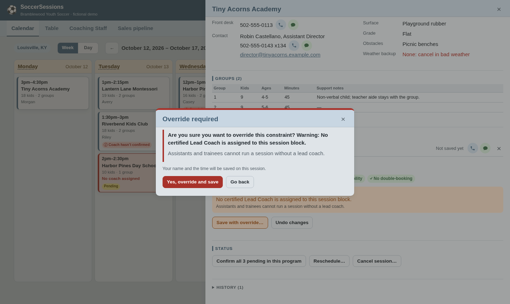</td>
</tr>
<tr>
<td>Sales can't submit a program the coaching staff can't cover, and gets alternatives.</td>
<td>Overrides name the exact rule broken and are logged.</td>
</tr>
<tr>
<td>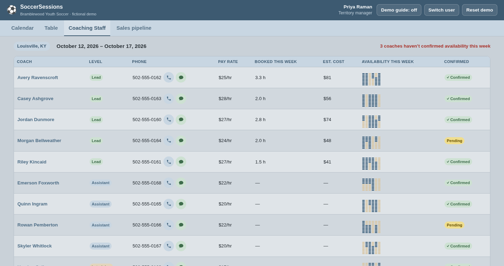</td>
<td>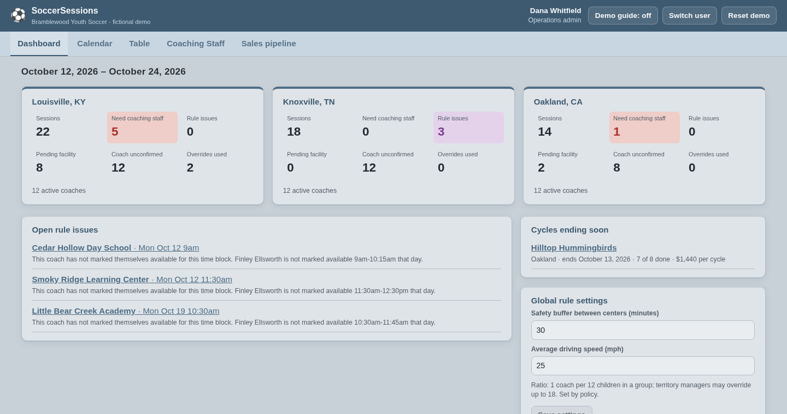</td>
</tr>
<tr>
<td>Coaching Staff: who has confirmed this week's availability, hours and cost.</td>
<td>Ops admin: every territory at a glance, cycles ending soon, global settings.</td>
</tr>
</table>

<table>
<tr>
<td>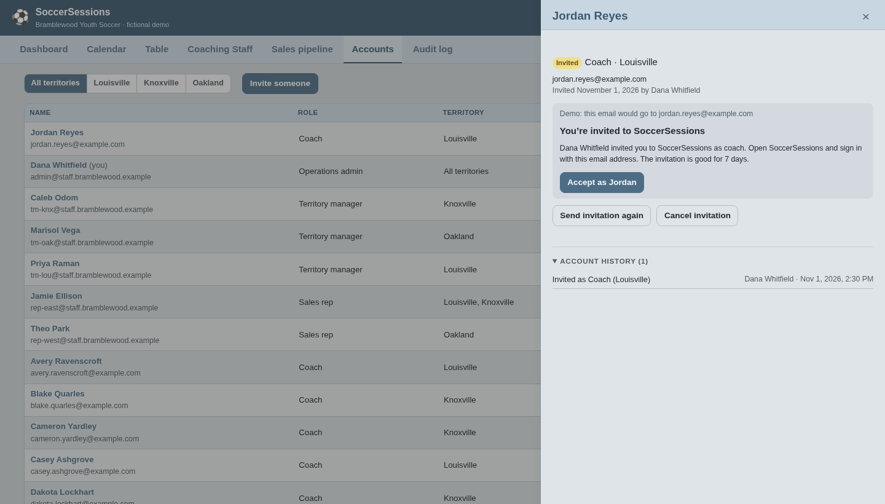</td>
<td>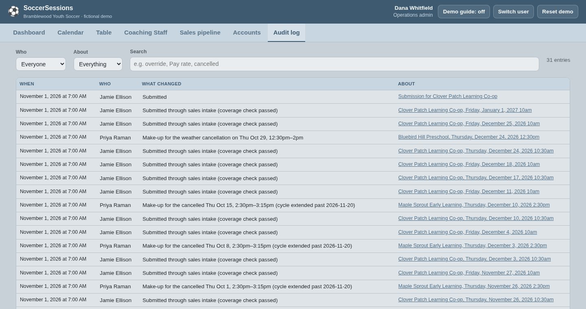</td>
</tr>
<tr>
<td>Accounts: people are invited, never handed a password; access is turned off, never deleted.</td>
<td>Audit log: every logged change in the company, who made it and when.</td>
</tr>
</table>

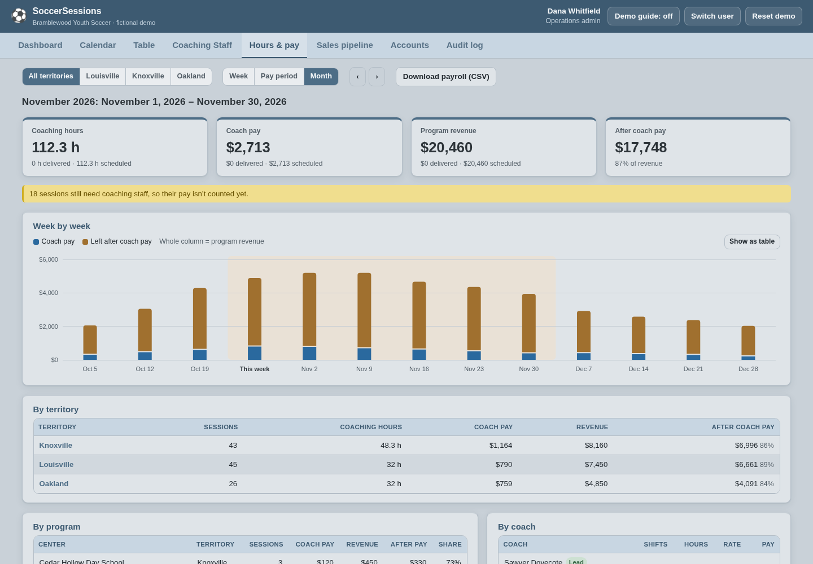

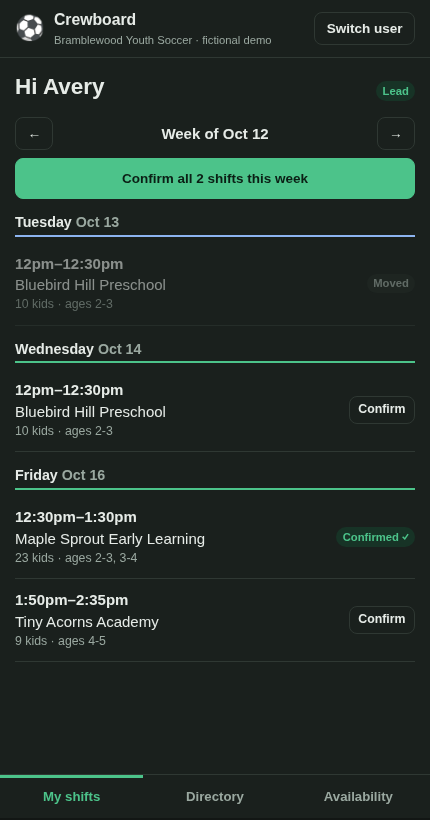

## The database version: real sign-in, shared data

The public demo runs entirely in your browser so anyone can try every role in a minute.
The same app also runs against a real database with real accounts: built on Supabase
(Postgres with sign-in) and tested end to end on a local copy in Docker. The plan, the
decisions and what changed at each step are in [docs/accounts-plan.md](docs/accounts-plan.md).

- **Invitation only, no passwords.** People are invited by email and sign in with a link
  or a 6-digit code. There's no sign-up form, and an unknown address gets the same answer
  as a known one, so the form can't reveal who works here.
- **Who you are comes from your sign-in,** never from the page address.
- **The database enforces the access rules.** Postgres row-level security mirrors
  `src/engine/access.ts`: a Knoxville manager's browser never receives Louisville's
  records, and pay rates and prices sit in tables coaches and reps can't read at all.
- **Browsers can only read.** Every change goes to a server function that runs the same
  action code as the demo, as the signed-in person, then saves the changed rows and
  their audit entries in one transaction. Nothing is ever half saved.
- **Nothing is deleted, and the audit log can only be added to.** The database refuses
  both, even for server code with full access.
- **Tested against the real thing.** 41 database tests sign in as all 42 people and check
  each one reads exactly what `access.ts` allows, make every kind of change as the person
  who'd really make it, and check that strangers, turned-off accounts, direct writes,
  deletes and audit-log edits are all refused. Loosening a rule on purpose makes them
  fail. GitHub runs them on every push.

```
browser ──reads──▶ Postgres, filtered by row-level security (= access.ts)
   │
   └── change ──▶ server function: same actions and rules as the demo, as the signed-in person
                     └──▶ apply_changes: the changed rows + their audit entries, one transaction
```

<table>
<tr>
<td>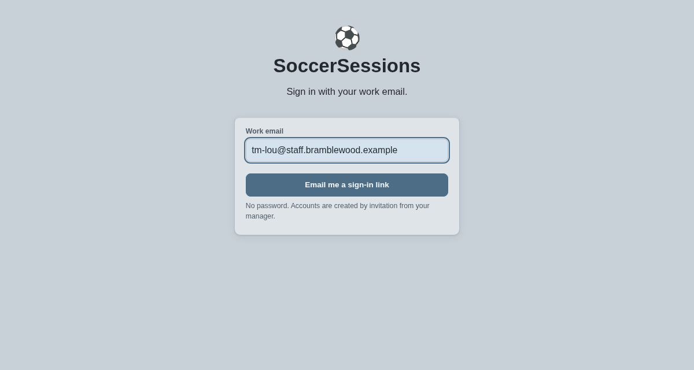</td>
<td>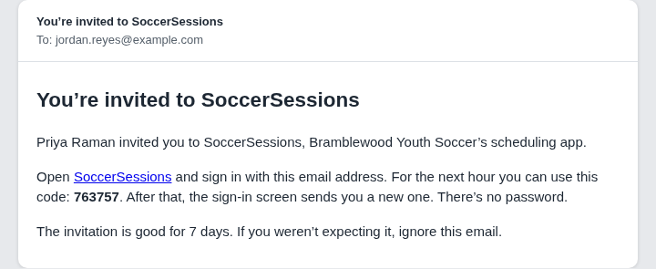</td>
<td>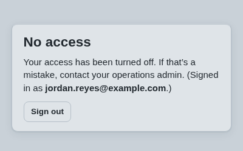</td>
</tr>
<tr>
<td>Sign in with your work email: a link or a code, no password.</td>
<td>The invitation a new coach receives.</td>
<td>Turned off: locked out at once, history kept.</td>
</tr>
</table>

## How it was built

I don't write code by hand. I build by directing AI coding agents (Claude Code): I
write the spec, make the product decisions, and check the agent's work against real
use.

1. **Spec first.** [PLAN.md](PLAN.md) is the spec, rewritten for a fictional company
   from the operating rules I enforced day to day: who sees what, the scheduling rules,
   the exact override wording, the intake fields and the lifecycle.
2. **Rules engine before screens.** The rules live in one module with no UI
   (`src/engine/`), so they can be tested directly. The territory manager's assignment
   screen and the sales intake call the *same* code, which is what the spec requires.
3. **Tests for every rule.** 257 automated tests (plus 41 that run against the
   database) cover the edge cases that matter in the field: a gap exactly equal to
   drive + buffer passes and one minute less fails,
   12 kids is fine, 13 needs a second coach, 19 with one coach is blocked even with an
   override, trainees don't count toward the ratio, a day off blocks only that day, a
   reschedule past the planned end pushes the cycle out, a Thursday + Friday program
   whose first three Thursdays were cancelled still delivers all 16 sessions and ends
   three weeks late, 16-week twice-a-week programs count correctly, a start date on the
   wrong weekday is refused, nothing can be deleted, and a
   sales rep can't submit an unstaffable program or edit a confirmed one even by skipping
   the UI. Another set checks the regenerated demo data for every week of the coming year.
4. **Demo data made by the engine.** The fake company is staffed by the real rules
   engine each week, then realistic problems are planted on purpose: a travel override, a
   ratio override, a reschedule, a weather cancellation whose make-up pushes a cycle back,
   a coach's vacation, a coach availability conflict, a new sale waiting for coaches.
5. **Reviewed like a real product.** v1 went live in one evening. Then I clicked through
   it the way I used to run the original, recording my screen and voice, and turned 37
   notes into v2: program terms owned by sales, cycle tracking, editable submissions,
   coach-owned availability with weekly check-ins and days off, reschedule notifications,
   and a calmer, clearer design. The plain-language list is in the
   [changelog](CHANGELOG.md).

6. **Planned before it was built.** The database version started as a written plan
   ([docs/accounts-plan.md](docs/accounts-plan.md)): the approach, the open decisions
   (provider, how coaches sign in, whether to run an online copy), and six phases, each
   shipped as its own tested version. The demo kept working at every step. Problems the
   tests caught along the way are written up in the plan and the changelog.

Decisions I made where the original spec was silent are listed in
[PLAN.md](PLAN.md#the-rules-engine).

## Project layout

```
src/engine/     Rules engine: types, time + distance, validation, coverage, lifecycle,
                access, availability, program cycles
src/data/       Actions (every change the app can make), queries, the audit log, the
                data sources (demo: this browser; live: the database), database row
                conversion, fictional company generator, ZIP lookup
src/store.ts    What the screens call; hands each change to the data source
server/         The server function (bundled into supabase/functions/)
src/views/      One screen per role or task (React)
supabase/       Local database setup, email templates, and the tables + read rules
                (migrations/)
tests/          Vitest unit tests for the engine, actions, queries, audit log and demo
                data; tests/db runs against the database, role by role
scripts/        Local database helpers, the server function build, screenshots
```

Built with TypeScript, React and Vite, and deployed to GitHub Pages by GitHub Actions
on every push (tests must pass first). The public demo has no backend: each visitor gets
their own copy of the demo company in localStorage. The database version adds Supabase
(Postgres, sign-in, a server function). A production deployment would add a hosted
Supabase project with an email sending service, a routing API for drive times and real
text messages. (The address search is the one live outside call: typed addresses go to
the free Photon service.)

## Run it locally

```bash
npm install
npm test          # all tests
npm run dev       # http://localhost:5173
npm run check     # type-check + lint + tests
```

The public demo needs nothing else. For the database version in progress (see
[docs/accounts-plan.md](docs/accounts-plan.md)), Docker runs a local Supabase:

```bash
npm run db:start  # build the server function, start the local database (first run downloads the images)
npm run db:reset  # empty it and load the fictional company, with a sign-in per person
npm run test:db   # sign in as every role: what each may read, and every kind of change saved
npm run dev:live  # the app in live mode at http://127.0.0.1:5173: sign in by email
                  # (emails land in the local catcher at http://127.0.0.1:54324)
npm run screenshots:live  # with dev:live running: the database version's screenshots
npm run db:stop
```

## Versions

Every release is tagged and described in plain language in [CHANGELOG.md](CHANGELOG.md).

## Roadmap

Calendar subscription (iCal) for
coaches · bulk-copy a schedule across N weeks · equipment bag inventory and custody ·
real SMS reminders.
