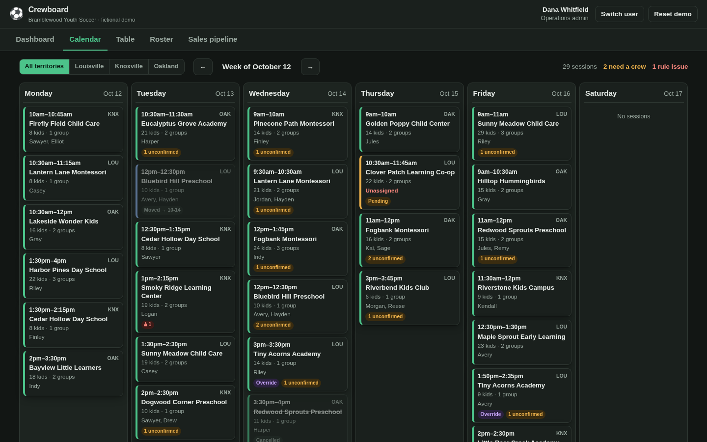

# Crewboard

**Live demo: https://lyversemason.github.io/crewboard/** (no login: pick a demo user)

Crewboard is a scheduling, staffing-rules and sales-intake system for a field-service
business: independent contractor coaches sent to daycares and schools across three
cities. It enforces the operating rules that keep sessions safe and staffable, and it
stops sales from booking a slot the roster can't cover.

It's a public rebuild of a system I designed and ran at a previous job (the original
is private). This version uses fresh code and a **fictional company, Bramblewood Youth
Soccer**. Every center, coach, phone number (555-01xx) and dollar figure is made up.



## Try it in two minutes

1. **Sales rep (Jamie Ellison).** Start a new center, pick a ZIP, then set a Saturday
   start and 40 kids. The live check says the roster **can't** cover it, Submit locks,
   and it offers open slots instead. Click one and it turns green.
2. **Territory manager, Knoxville (Caleb Odom).** One session shows ⚠: a coach changed
   their availability. Open it. Every coach in the dropdown is labeled *free*,
   *travel*, *not available* or *busy*. Put an assistant on alone and save, and you get
   the exact override warning from the spec.
3. **Coach (phone view).** Tap a shift: the address opens Maps and every phone number
   can call or text. Then "Confirm all shifts this week".
4. **Ops admin (Dana Whitfield).** Change the safety buffer from 30 to 60 minutes and
   watch new travel-time issues appear across territories.

Everything you change is saved in your browser only. **Reset demo** restores it.

## What it does

| | |
|---|---|
| **Role-based access** | Ops admins see all territories; territory managers only theirs; sales reps only the intake pipeline; coaches only their own shifts. Pay rates and contract money are stripped from the data for non-managers, not just hidden. |
| **Rules engine** | Blocks double-booking. Checks drive time between centers plus a configurable safety buffer, requires a lead coach on every session, and enforces 1 coach per 12 children (13 kids means a second coach). Managers can override with an explicit warning, up to 18 per coach and never past that. |
| **Sales intake** | Captures facility, contact, cadence, groups (ages, minutes, support notes), space and weather backup. A live check proves a qualified crew exists on **every** date using the same rules with no overrides, without assigning anyone. If it can't, Submit is locked and open slots are suggested. |
| **Session lifecycle** | Pending → confirmed → rescheduled / cancelled. **Nothing is ever deleted**: a reschedule keeps the original and links a new session, and a cancellation needs a reason code. Every change is logged with who and when. |
| **Manager views** | Week calendar (days visually separated) and a filterable table, with live rule badges, unassigned sessions and coach confirmations. Also a roster with an availability editor and a sales pipeline with program terms and margin per session. |
| **Coach phone view** | My shifts by day, a full shift package, tap-to-map, tap-to-call/text, shift-mates, confirm one shift or the whole week, territory directory, weekly availability. |

<table>
<tr>
<td></td>
<td></td>
</tr>
<tr>
<td>Sales can't submit a slot the roster can't staff, and gets alternatives.</td>
<td>Overrides name the exact rule broken and are logged.</td>
</tr>
<tr>
<td></td>
<td></td>
</tr>
<tr>
<td>Session panel: crew, rule checks with drive minutes, history.</td>
<td>Ops admin: every territory at a glance, global rule settings.</td>
</tr>
</table>


## How it was built

I don't write code by hand. I build by directing AI coding agents (Claude Code): I
write the spec, make the product decisions, and check the agent's work against real
use. This rebuild took one evening.

1. **Spec first.** [PLAN.md](PLAN.md) is the spec, rewritten for a fictional company
   from the operating rules I enforced day to day: who sees what, the five scheduling
   rules, the exact override wording, the intake fields and the lifecycle.
2. **Rules engine before screens.** The rules live in one module with no UI
   (`src/engine/`), so they can be tested directly. Managers' assignment screen and the
   sales intake call the *same* code, which is what the spec requires.
3. **Tests for every rule.** 134 automated tests cover the edge cases that matter in
   the field: a gap exactly equal to drive + buffer passes and one minute less fails,
   12 kids is fine, 13 needs a second coach, 19 with one coach is blocked even with an
   override, trainees don't count toward the ratio, nothing can be deleted, and a sales
   rep can't submit an unstaffable slot even by skipping the UI. A further set checks
   that the regenerated demo data is valid for every week of the coming year.
4. **Demo data made by the engine.** The fake company is staffed by the real rules
   engine each week, then a few realistic problems are planted on purpose (a travel
   override, a ratio override, a reschedule, a cancellation, a coach availability
   conflict, a new sale waiting for a crew).
5. **Checked in a real browser, not just tests.** Clicking through every role found
   bugs the tests couldn't. One was a style clash that drew phone numbers as
   full-height boxes. Another: a travel override showed as "fixed" on the new session
   but still flagged the coach's *earlier* session, so the engine now treats an override
   on either session as covering the pair. Also, on weekends the default view showed
   only finished sessions, so it now opens on the coming week.

Decisions I made where the original spec was silent are listed in
[PLAN.md](PLAN.md#the-rules-engine).

## Project layout

```
src/engine/     Rules engine: types, time + distance, validation, coverage, lifecycle, access
src/data/       Fictional company generator and ZIP lookup
src/store.ts    The only place data changes, always through the engine
src/views/      One screen per role or task (React)
tests/          Vitest unit tests for the engine, store actions and demo data
scripts/        Screenshot generator for this README
```

Built with TypeScript, React and Vite, and deployed to GitHub Pages by GitHub Actions
on every push (tests must pass first). There's no backend: each visitor gets their own
copy of the demo company in localStorage. A production version would add real sign-in,
a shared database, a routing API for drive times and an address-verification API.

## Run it locally

```bash
npm install
npm test          # 134 tests
npm run dev       # http://localhost:5173
npm run check     # type-check + lint + tests
```

## Versions

Every release is tagged and described in plain language in [CHANGELOG.md](CHANGELOG.md).

## Roadmap

Dated availability exceptions and weekly re-confirm reminders · hours × pay rate by
week, month and 3-week pay cycle · calendar subscription (iCal) for coaches · bulk-copy
a cadence across N weeks · equipment bag inventory and custody.
